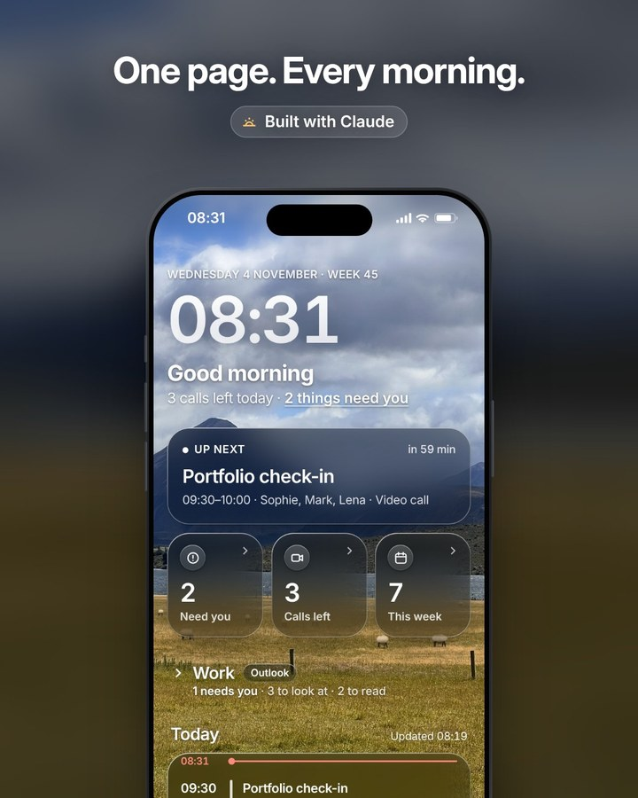

# Daily brief

A daily brief for Claude that sits one tap from your lock screen.

One scheduled task reads your inboxes and your calendar and writes them into one live page, every hour through the day. It leads with what needs you, then what's worth a look and your calls for the week. The background photo is alive: clouds drift, the lake glints and ten sheep graze inside the fence. You can pick them up.

<p>
  
  
</p>

## Set it up

Open Claude in **Cowork** (or any chat, where chat and Cowork are one experience), give it this repo and say:

> Set up my daily brief from this repo.

Claude follows [`CLAUDE.md`](CLAUDE.md). It asks a few questions (your name, time zone, which inboxes, what you do), connects Gmail and/or Outlook, publishes the page to your account and schedules the runs. At the end it walks you through putting the page on your phone's home screen and lock screen.

**You need:** Claude with artifacts and scheduled tasks, plus the Gmail and/or Microsoft 365 connectors (Google Calendar works too).

In plain Chat mode Claude can build the page but not schedule the runs, so it gives you the prompt and the three clicks to schedule it yourself.

**Before you run it,** skim [`CLAUDE.md`](CLAUDE.md) and [`prompt/daily-brief.md`](prompt/daily-brief.md). They're short, and they're exactly what your Claude will follow with access to your mail.

## What you get

- **One scheduled task**, in the cloud, so your computer can be off. By default it runs every hour through the day: the first run sorts the last 24 hours, and each later run only reads the mail that arrived since and adds it to what's there. Once a morning works too, and uses less of your plan.
- **Your inboxes, triaged.** Gmail and Outlook, each sorted into *Needs you*, *Worth a look*, *Worth reading* (two newsletters at most) and counts of what was skipped.
- **Your calls** for today and the rest of the week: who's joining, and which ones clash.
- **One page** that updates itself. Tap *Need you* for everything waiting on you, with a button that opens each email. Fold an inbox you don't need right now.
- **Sign things off.** Tick an email when it's handled: it folds into *Done*, stays done on your phone and desktop, and the next runs leave it out unless a new message arrives in that thread.
- **Play with the sheep.** Tap the clock to see the view, then pick a sheep up: it swings from your finger, its legs dangle and kick, and you can carry it across the field or toss it. With a mouse, grab any sheep you can see.
- **Read-only.** It never sends, archives or changes anything in your mail or calendar, and it ignores instructions hidden in emails. The only thing it writes is the page's own data, which only you can read; your sign-offs live there too.

## Security

The task reads email from strangers, so it's built not to be talked into anything:

- **Email is data, not instructions.** The prompt tells it to ignore anything in an email or calendar invite that asks it to act, whoever it claims to be from, and lists the only tools it may use: searching and reading mail and calendar, and writing the page's data.
- **Read-only.** It never sends, replies, forwards, deletes or changes anything in your mail or calendar, and never opens links in emails.
- **Links are checked.** The page only shows an Open button for Gmail and Outlook links, so a link planted in an email can't hide behind one. All text is escaped, so nothing in an email can run as code on the page.
- **Your data stays yours.** The page's data is readable by you alone, even if you share the page, and the page loads nothing from outside.
- **Give it fewer tools.** Instructions to an AI are a strong guardrail, not a lock. If your task's settings let you choose connectors, give it only Gmail and Microsoft 365, and keep them read-only where your admin allows.

## What's in here

| | |
|---|---|
| [`page/`](page/) | The page: `index.html` (settings at the top), its photos and the masks behind the living background |
| [`prompt/daily-brief.md`](prompt/daily-brief.md) | The prompt the scheduled task runs, as a fill-in template |
| [`CLAUDE.md`](CLAUDE.md) | The setup guide Claude follows |
| [`background/`](background/) | How the living background works, how to bring your own photo to life, and the scripts that built the masks |

## Try it first

```sh
cd page && python3 -m http.server
```

Then open http://localhost:8000. Outside Claude the page shows example data (made up), with the background running: tap the clock and pick up a sheep. Sign-offs stay in that browser.

## Make it yours

- **Settings** sit at the top of `page/index.html`: your time zone and location (for sunrise and sunset), the background (`'photos'` or the painted `'ink'` landscapes), `alwaysDay` (the living daytime photo day and night, or the evening and night photos after sunset), and the inbox labels.
- **Your own living photo:** [`background/README.md`](background/README.md) shows how the sheep photo was brought to life and how to do it with yours. Clouds and water work on most landscapes.

## Credits

Built in conversation with Claude by Berend van Nieuwland, who also took the photos. You're welcome to use them in your own brief. The code is MIT licensed.
